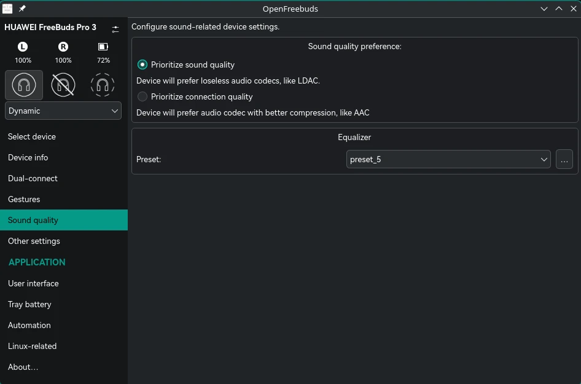
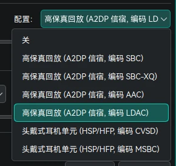

+++
date = '2026-10-09T12:00:00+08:00'
draft = false
title = 'HUAWEI Freebuds 在 Fedora 上使用 LDAC 音频编码'
categories = ['Resource']
tags = ['Notes']
+++

# 引入

最近用 Fedora 发现 HUAWEI Freebuds 3 Pro 显示支持的最高的蓝牙音频编码是 AAC 而不是更优的 LDAC，但是这款耳机明显是支持 LDAC 的。我本来以为是系统的 LDAC 支持问题，折腾一顿后发现是需要华为音频管家处选择更优质的编码格式才给设备开放 LDAC（见[帮助文档](https://consumer.huawei.com/cn/support/content/zh-cn16000628/)）。~~我去，华为你做耳机给我做好了呀！~~

# 解决方案

使用社区开发的 [OpenFreebuds](https://github.com/melianmiko/OpenFreebuds) 解决，支持 Windows 和 Fedora。在 Fedora 上推荐使用 Flatpak 安装。

```shell
flatpak install pw.mmk.OpenFreebuds
```

连接上耳机后，程序会自动识别到耳机并进行对接。在 `Sound quality` 处选择，`Prioritize sound quality` 即可对当前连接设备解锁 LDAC 音频编码。



选中后，蓝牙音频协议会短暂重新握手，然后就可以在配置处看到已经有 LDAC 编码选项了。



然后就是……慢慢享用哦～
