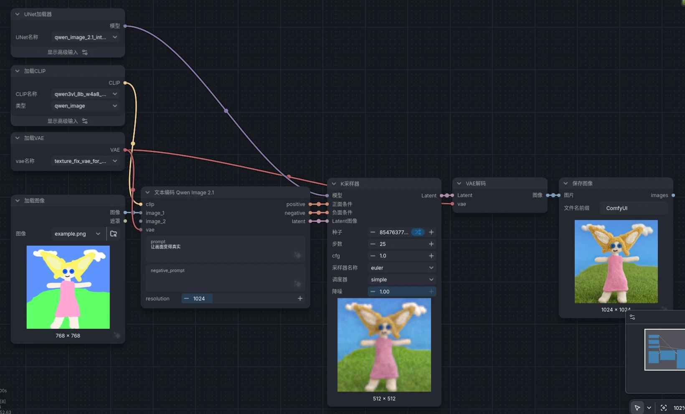

+++
date = '2026-11-09T18:00:00+08:00'
draft = false
title = '在 RTX4060 Laptop 8GB 上使用 ComfyUI 低压力跑图实践'
categories = ['Deploy']
tags = ['Notes', 'AI']
+++

## 关于 QwenImage 2.1

见 [HuggingFace 页面](https://huggingface.co/Qwen/Qwen-Image-2.1)，这是阿里开源的一个 DiT(Diffusion in Transformer) 架构的 T2I(文生图)、I2I(图生图)模型，仅有 7B 的参数量。

最小工作流仅需 transformer、vae 和 text_encoder，可选 PE 模型(提示词增强)。

一些社区资源目录见 [GitHub 页面](https://github.com/wildminder/awesome-qwen-image)。

[常用计算模型显存占用需求工具](https://modelvram.com/qwen-image-2-1-vram-calculator/?dit=q8_0&enc=int8&vae=bf16&mode=resident&work=1mp)

## 普通消费级显卡部署实践

### ComfyUI 部署

系统环境：Fedora 44(7.2.15-200.fc44.x86_64)、NVIDIA-SMI 615.78.08(RTX 4060 Laptop 8GB)

> 以下使用的是非 Turbo 模型

首先部署运行环境

```bash
# 确保安装 uv，如已安装请跳过
curl -LsSf https://astral.sh/uv/install.sh | sh

# 在一个空文件内拉取 ComfyUI
git clone https://github.com/Comfy-Org/ComfyUI.git
cd ComfyUI

# 初始化虚拟环境并安装依赖
# cpy311 可以达到良好的兼容性，cpy313 可达良好的性能，按需选择
uv venv --python cpython3.13
# PyTorch 需要选择安装 CUDA(NVIDIA) 或者 ROCm(AMD) 的
# 在 https://pytorch.org/get-started/locally/ 选择，此处以 CUDA134 为例子
# 如果你是 NPU 或者其他 GPU 需要找对应文档教程
uv pip install torch torchvision --index-url https://download.pytorch.org/whl/cu134
uv pip install -r requirements.txt
```

完成了一个简单的运行环境部署，如果不追求极致的速度，可以直接用下面的调优好的参数启动

```bash
uv run main.py --use-ck-attention --disable-pinned-memory --preview-method auto --fast-disk
```

随后访问 http://127.0.0.1:8188 即可打开 ComfyUI 的 Web 界面

### QwenImage2.1 模型下载

> 模型放入文件夹后需要刷新页面才能看到

主模型：[QwenImage 2.1 INT8 ConvRot](https://huggingface.co/Comfy-Org/Qwen-Image-2.1/blob/main/diffusion_models/qwen_image_2.1_int8_convrot.safetensors) 放在 models/diffusion_models/ 文件夹中

文本编码器：[Qwen3VL 8B W4A8](https://huggingface.co/Comfy-Org/Qwen3-VL/blob/main/text_encoders/qwen3vl_8b_w4a8.safetensors) 放在 models/text_encoders/ 文件夹中

VAE: [Texture Fix VAE BF16](https://huggingface.co/madebyollin/texture-fix-vae-for-qwen-image-2.1/blob/main/texture_fix_vae_for_qwen_image_2.1_bf16.safetensors) 放在 models/vae/ 文件夹中

如果无法访问以上地址，可以使用镜像源配合 hf CLI 下载

```bash
export HF_ENDPOINT=https://hf-mirror.com
uv tool install huggingface_hub[cli]
# 主模型
hf download hf://Comfy-Org/Qwen-Image-2.1/diffusion_models/qwen_image_2.1_int8_convrot.safetensors
# 文本编码器
hf download hf://Comfy-Org/Qwen3-VL/text_encoders/qwen3vl_8b_w4a8.safetensors
# VAE
hf download hf://madebyollin/texture-fix-vae-for-qwen-image-2.1/texture_fix_vae_for_qwen_image_2.1_bf16.safetensors
```

### 工作流



调度器和采样器不需要额外调整(euler+simple)，建议 25 步获得更好的结果。
QwenImage 2.1 通常不需要负面提示词，$CFG=1$ 已足够。如果需要负面提示词压制一些意外的效果，需要调整 $CFG >= 3$。

速度情况：`[01:05<00:00,  2.61s/it]`

### 额外资源分享

目前较新环境的依赖普遍缺少预编译包，实在找不到的只能自己编译了 :<

[Flash Attention 预编译包地址](https://github.com/mjun0812/flash-attention-prebuild-wheels/releases)

如果你是 Windows 机器，还可以从[这个仓库获取预编译包](https://github.com/wildminder/AI-windows-whl)

下面是我自己编译的一些 whl 包，有需要的可以自取。

https://tangge233.lanzouc.com/b0xxq38pe
密码:2333

|文件名|内容|描述|
|--|--|--|
|xformers.zip|xformers-0.0.35+cu134torch2.15-cp313-cp313-linux_x86_64.whl|仅支持 sm_89 架构|
|sageattention-2.2.0.zip|sageattention-2.2.0-cp311-cp311-linux_x86_64 和 sageattention-2.2.0-cp313-cp313-linux_x86_64|仅支持 sm_89 架构|

## 后记

在消费级显卡上，我初次部署使用的是全 GGUF 的 Q4_K_M 量化架构，将 CLIP 文本编码模型卸载到了 CPU 上运行。但直接就遇到了几个问题，首先是单次迭代的时间非常长，大约 30s/it，25 步需要 10 多分钟，非常影响体验。而且编码器被完全卸载到了 CPU 上后，内存和 SWAP 基本都被占满，其余任务基本不能跑。通过换用 SageAttention 后，速度缓解到了 12s/it，快了点，但不是很多。

然后尝试玩 LoRA 微调模型，结果发现 GGUF 量化的模型的一些注意力块是 unfused 的，而大多数 LoRA 则是 fused 的，ComfyUI 暂时无法处理此类模型与 LoRA 的结合。不过这仅是一些保存格式的差异，有对应关系，于是我[弄了个自定义节点来缓解此问题](https://github.com/tangge233/ComfyUI-UnfusedQwenImageLoraFix)，让 LoRA 能正常工作。

后来了解到了 ConvRot 对 DiT 量化模型的优化技术，在几乎不损失质量的情况下，降低了量化模型的异常值并大幅降低显存需求、缩短了运行时间。并且 INT8 数据对于 Ada 架构是非常友好的，有硬件加速路径。

目前模型在跑图的时候显卡是有空余算力的，估计是遇到数据流速度瓶颈了，可以尝试 KV 缓存等节点优化，不过目前的速度已经很快。非满占用也能稍微缓解由于跑图导致的桌面环境卡顿。

后面就是可以愉快地探索学习了 :)
